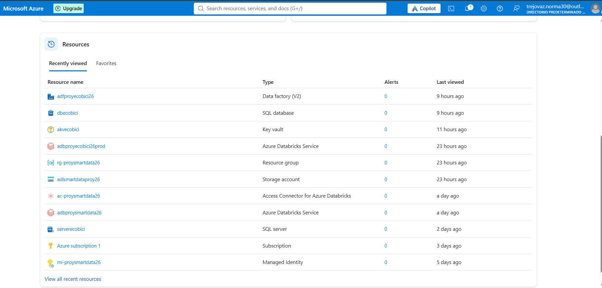
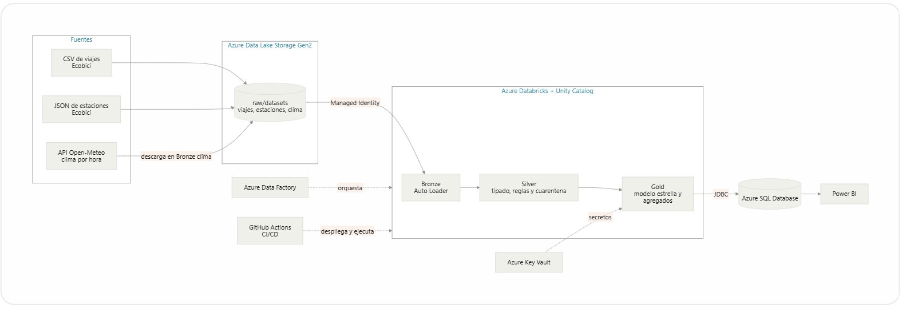
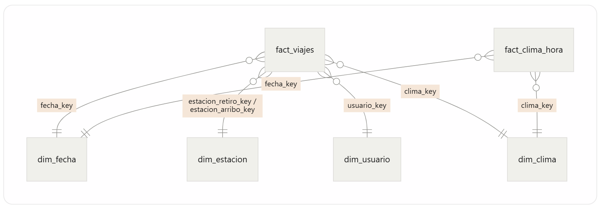
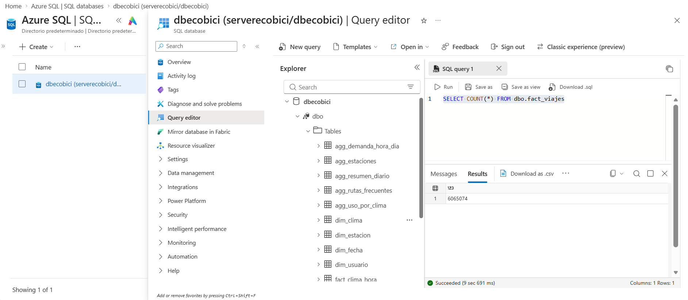
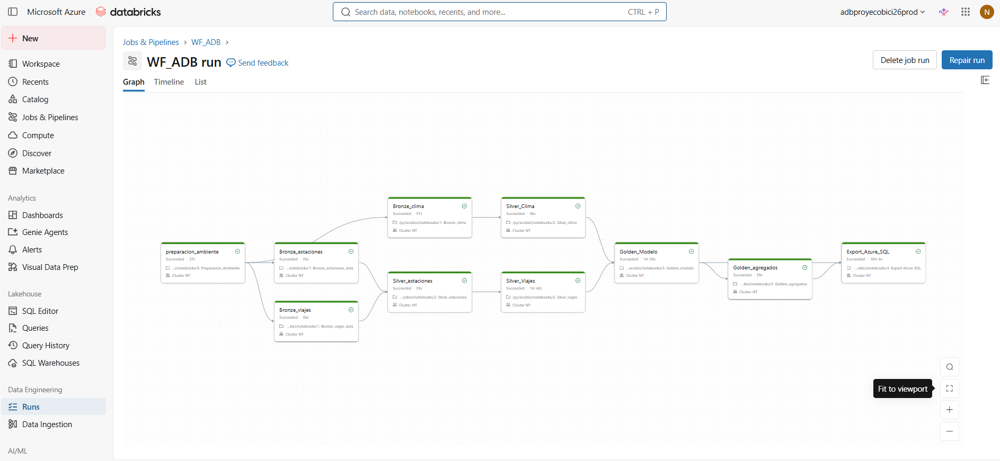
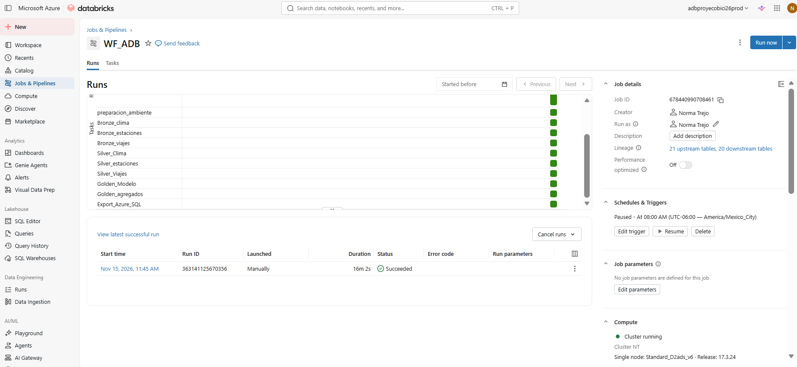
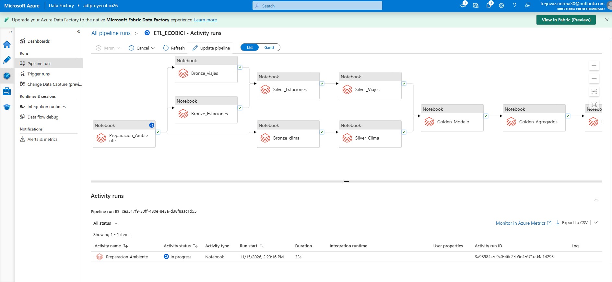
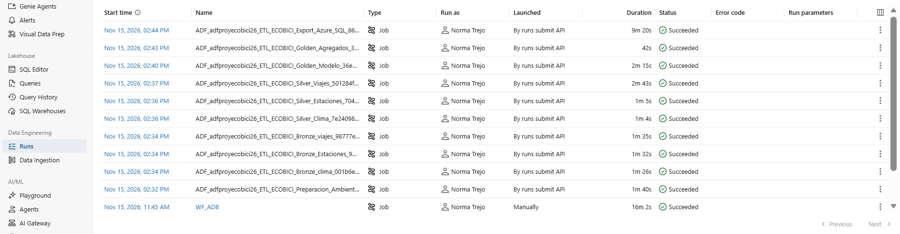
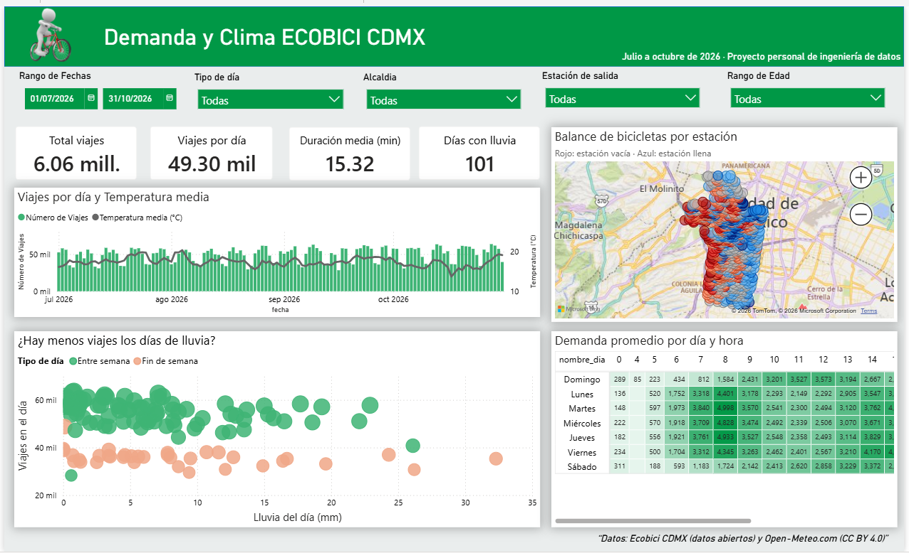

# CICDPROYECOBICI
Pipeline ETL con arquitectura Medallion en Azure Databricks y PySpark. Integra viajes y estaciones de Ecobici CDMX con clima de Open-Meteo, usa Unity Catalog, Managed Identity y Key Vault, y publica un modelo estrella en Azure SQL Database para analizarlo en Power BI. Despliegue con CI/CD.

# Ecobici CDMX: demanda y clima con Azure Databricks
Pipeline ETL con arquitectura Medallion (Bronze, Silver y Gold) en Azure Databricks y PySpark. Integra viajes y estaciones de Ecobici CDMX con clima por hora de Open-Meteo, usa Unity Catalog, Managed Identity y Key Vault, y publica un modelo estrella en Azure SQL Database para analizarlo en Power BI. Despliegue con CI/CD (GitHub Actions y la API REST de Databricks).

### 1. Problema y objetivo

Un sistema de bicicletas compartidas necesita tener biciclets donde y cuando la gente las busca. Si una estación se vacía, el usuario no puede salir; si se llena, no puede dejar la bici. Además, la demanda cambia con la hora, el día y el clima.

Este proyecto responde con datos abiertos:

- ¿A qué horas y qué días se usa más el sistema?
- ¿Qué estaciones se vacían o se llenan (balance de llegadas contra salidas)?
- ¿Cambia el uso con la lluvia o la temperatura?

**Periodo analizado:** 1 de julio al 31 de octubre de 2026 (4 meses, 123 días) por motivos de volumen de datos datos cargados 6 millones.

### 2. Arquitectura

**Servicios de Azure y herramientas**

-** Azure Data Lake Storage Gen2:** Capa raw con los archivos de origen. Acceso solo con Managed Identity
-** Azure Databricks:** Procesamiento con PySpark (DataFrame API) y Delta Lake
- **Unity Catalog:** Catálogos por ambiente, esquemas por capa, permisos por grupo y ubicaciones externas
- **Azure Key Vault:** Usuario y contraseña de SQL, expuestos a Databricks mediante un secret scope
- **Azure SQL Database:** Destino de la capa Gold
- **Azure Data Factory:** Pipeline ETL_ECOBICI que orquesta los notebooks
- **Databricks Workflows:** Job WF_ADB con las dependencias entre tareas
- **GitHub Actions CI/CD:** despliega los notebooks y el workflow en producción
Power BI: Tablero conectado a Azure SQL

### 3. Fuentes de datos

- **Viajes de Ecobici:**	CSV, un archivo por mes	Un registro por viaje: género, edad, bicicleta, estaciones y fechas de retiro y arribo
- **Estaciones de Ecobici:**	JSON	Catálogo de cicloestaciones: ubicación, colonia, alcaldía y coordenadas
- **Open-Meteo:**	API REST (JSON), Temperatura, humedad, precipitación, viento y código de clima por hora (CDMX)

**Ruta de la capa raw:** abfss://raw@<cuenta>.dfs.core.windows.net/datasets/{viajes | estaciones | clima}. No se usa DBFS ni volúmenes.

### 4. Capas del modelo Medallion

**Bronze (datos tal como llegan)**

- **Viajes:** Auto Loader (cloudFiles, availableNow) lee los CSV como texto, sin transformar, y agrega columnas de origen (_archivo_origen, _fecha_ingesta). El checkpoint es independiente por catálogo, para que dev y prod no se interfieran.
- **Estaciones:** lectura del JSON y escritura a Delta.
- **Clima:** descarga por año de la API de Open-Meteo, que se guarda como JSON en raw y se lee con Spark.

**Tablas:** bronze.viajes_raw, bronze.estaciones_raw, bronze.clima_raw.

**Silver (datos limpios y validados)**

Cada fila recibe, como máximo, un motivo de rechazo. Las filas inválidas no se pierden: pasan a tablas de cuarentena con su motivo_rechazo, y cada notebook verifica que Bronze = Silver + Cuarentena.

**Tabla de entrada: Reglas principales**
- **Viajes:** fecha inválida, estación inválida, edad fuera de rango (14 a 90), arribo antes del retiro, duración cero o mayor a 24 h, fuera del mes del archivo, estación fuera del catálogo y duplicados
- **Estaciones:** número inválido, coordenadas fuera de la CDMX, duplicados
- **Clima:** fecha inválida, medición nula, valores fuera de rango y horas duplicadas

**Decisiones de diseño:**

- Género no disponible: un género distinto de M, F u O (por ejemplo ?) no rechaza el viaje; se conserva como ND.
- Estaciones con rango (por ejemplo 271-272, dos cicloestaciones en la misma ubicación): se usa el primer número, se marca el viaje con una bandera y el catálogo conserva ambas filas con un id_ubicacion común.
- Modo ANSI: las conversiones de tipo usan expresiones seguras (validación con rlike y try_to_timestamp), de modo que un valor malo va a cuarentena y no detiene el proceso.

**Tablas:** silver.viajes, silver.viajes_cuarentena, silver.resumen_calidad_viajes, silver.estaciones, silver.estaciones_cuarentena, silver.clima_hora, silver.clima_cuarentena.

**Gold (listo para análisis)**

**Modelo estrella**

- fact_viajes: un viaje (con la llave de clima de su hora de salida)
- fact_clima_hora: una hora de clima
- dim_fecha, dim_estacion, dim_usuario, dim_clima:	día, cicloestación, género × rango de edad y combinación de clima

Los viajes sin clima para su hora usan la llave -1 ("Sin dato"). El notebook verifica integridad referencial (cero llaves huérfanas).

**Tablas agregadas**

agg_demanda_hora_dia, agg_estaciones, agg_rutas_frecuentes, agg_uso_por_clima y agg_resumen_diario. Sus totales se verifican contra fact_viajes.

**Exportación a Azure SQL**

Las tablas Gold se copian por JDBC a Azure SQL Database. Las credenciales salen de Key Vault (secret scope), nunca del código, y al final se compara el número de filas entre Databricks y SQL.

**Resultados en cifras**

- Periodo	1 de julio al 31 de octubre de 2026 (123 días)
- Viajes en Gold (fact_viajes)	6,065,074
- Cicloestaciones en el catálogo	689 (los rangos como 271-272 se separan en dos filas)
- Horas de clima	2,952 (123 días × 24 horas)
- Tablas en Azure SQL	11 (dimensiones, hechos y agregados), con el conteo de filas verificado contra Databricks

### 5. Orquestación y CI/CD

Orden de ejecución:

- **Databricks Workflow (WF_ADB):** definido y creado por el pipeline de CI/CD, con una tarea por notebook y sus dependencias.

- **Azure Data Factory (ETL_ECOBICI):** ejecuta los mismos notebooks en el mismo orden mediante actividades de Databricks.

- **CI/CD con GitHub Actions (.github/workflows):** en cada push a main
exporta los notebooks del workspace de desarrollo,
los importa al workspace de producción,
vuelve a crear el job WF_ADB apuntando al catálogo de producción,
lo ejecuta y monitorea su avance.

- **Ambientes:** catalog_ecobici_dev (desarrollo) y catalog_ecobici_prod (producción).

Los tokens y las direcciones de los workspaces se guardan como secrets del repositorio, no en el código.

### 6. Seguridad y gobierno
- Managed Identity para leer el Data Lake (credencial de almacenamiento y ubicaciones externas en Unity Catalog).
- Key Vault para las credenciales de SQL.
- Permisos por grupo en Unity Catalog (USE CATALOG, USE SCHEMA y SELECT):
- Permisosn Grants
DEs (ingeniería de datos)	crear tablas en silver
DS (ciencia de datos)	leer silver y golden
BI	leer golden
QAs	leer silver

### 7. Tablero de Power BI

Conectado a Azure SQL Database (dbecobici). Una página con filtros por rango de fechas, tipo de día, alcaldía, estación de salida y rango de edad, y estos elementos:

- **Indicadores:** viajes totales, viajes por día, duración media y días con lluvia (un día de lluvia es uno con 1 mm o más).
- **Grafico 1:** Viajes por día y temperatura media, a lo largo del periodo.
- **Mapa de balance de bicis por estación:** rojo si la estación se vacía, azul si se llena.
- **Mapa de calor de la demanda promedio por día de la semana y hora.**
- **Grafico de dispersión:** Relación entre la lluvia del día y los viajes, separando entre semana y fin de semana.

### 8. Hallazgos

- **Horas pico entre semana:** la demanda alcanza su máximo alrededor de las 8:00 y de las 17:00 a 18:00 h, con unos 4 a 5 mil viajes por hora, un patrón de entrada y salida del trabajo.
- **Fin de semana:** hay menos viajes y se concentran a mitad del día, sin los picos de la mañana y la tarde.
- **Entre semana contra fin de semana:** los días hábiles rondan los 45 a 65 mil viajes y los fines de semana, los 30 a 40 mil.
- **Balance de estaciones:** hay estaciones que reciben más bicis de las que salen y otras que se vacían; es la información que serviría para decidir dónde reponer bicis.
- **Lluvia:** en los datos de estos cuatro meses no se aprecia una caída clara de los viajes en los días más lluviosos; hay días hábiles con más de 20 mm que siguen cerca de los 50 mil viajes.

La relación entre clima y uso es observada, no demuestra causalidad: por ejemplo, llueve más por la tarde y la demanda también cambia con la hora. El periodo analizado es de 4 meses y coincide con la temporada de lluvias.

### 9. Atribución y licencias

**Datos meteorológicos:** Open-Meteo.com, licencia CC BY 4.0.
**Datos de viajes y estaciones:** Ecobici CDMX, datos abiertos de la Ciudad de México.

